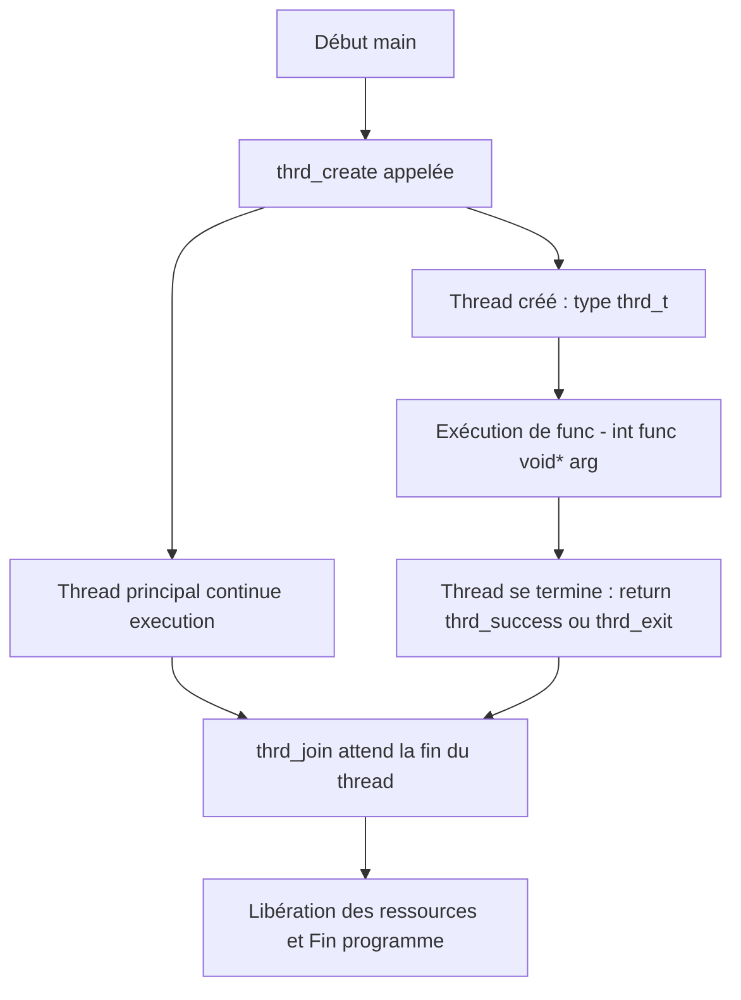

# 5-Séance 5 : Programmation Système et Multitâche  
## 2-Introduction aux Threads Standards (C11 `<threads.h>`)  
### 1-Création et gestion des threads avec `thrd_create`  

---

## Introduction  
Les threads permettent d'exécuter plusieurs séquences d'instructions de manière concurrente au sein d'un même processus, en partageant le même espace d'adressage mémoire. Historiquement, l'API POSIX (`pthread.h`) était le standard sous UNIX/Linux. Depuis la norme **C11**, le langage C intègre nativement la gestion des threads via l'en-tête `<threads.h>`. 

L'avantage majeur du standard C11 est sa **portabilité cross-platform** : le même code source C11 compile et s'exécute nativement sous **Linux**, **Windows** et **macOS** sans aucune modification.

---

## 1. Qu’est-ce qu’un thread C11 ?  

- Un **thread** est une unité d’exécution légère au sein d'un processus.  
- Il partage la mémoire globale et le tas (*heap*) avec les autres threads du processus, mais possède sa propre pile d'exécution (*stack*).  
- Il permet d'exploiter efficacement les processeurs multi-cœurs.  

---

## 2. La fonction `thrd_create` : création d’un thread  

### 2.1 Prototype  

```c
#include <threads.h>

int thrd_create(thrd_t *thr, thrd_start_t func, void *arg);
```

- `thr` : Pointeur vers une variable de type `thrd_t` dans laquelle le système stocke l'identifiant du thread créé.  
- `func` : Pointeur vers la fonction à exécuter dans le thread. Le prototype de cette fonction doit être exactement :  
  `int fonction(void *arg)`
- `arg` : Pointeur générique (`void *`) transmis comme argument à la fonction `func`.  

### 2.2 Valeur de retour  
- `thrd_success` : Si le thread a été créé avec succès.  
- `thrd_nomem` : Si la mémoire est insuffisante pour créer le thread.  
- `thrd_error` : En cas d'erreur générale lors de la création.  

---

## 3. Attente et terminaison : `thrd_join` et `thrd_exit`

- **`thrd_join(thrd_t thr, int *res)`** : Bloque le thread appelant jusqu'à ce que le thread spécifié `thr` se termine. La valeur de retour du thread est stockée dans la variable pointée par `res` (peut être `NULL`).
- **`thrd_exit(int res)`** : Termine immédiatement le thread appelant en renvoyant le code de sortie `res`.

---

## 4. Exemple complet portable (Linux & Windows)

```c
#include <stdio.h>
#include <stdlib.h>
#include <threads.h>

// Fonction exécutée par le thread
int thread_function(void *arg) {
    int id = *((int *)arg);
    printf("[Thread %d] Exécution démarrée.\n", id);
    
    // Le thread se termine en renvoyant la valeur thrd_success (0)
    return thrd_success;
}

int main(void) {
    thrd_t thread;
    int id = 1;
    int result;

    printf("[MAIN] Création du thread...\n");

    // Création du thread
    if (thrd_create(&thread, thread_function, &id) != thrd_success) {
        fprintf(stderr, "Erreur lors de la création du thread.\n");
        return EXIT_FAILURE;
    }

    // Attente de la fin du thread
    thrd_join(thread, &result);

    printf("[MAIN] Le thread s'est terminé avec le code : %d\n", result);

    return EXIT_SUCCESS;
}
```

---

## 5. Instructions de compilation Multi-Plateformes

### 🐧 Sous Linux / macOS (GCC ou Clang)
Le drapeau `-pthread` permet d'insérer le runtime de threads sous-jacent.
```bash
gcc -std=c11 -pthread programme.c -o programme
./programme
```

### 🪟 Sous Windows

1. **Avec MSVC (Visual Studio 2022 v17.8 et ultérieur) :**
   ```cmd
   cl /std:c11 programme.c
   programme.exe
   ```
2. **Avec MinGW-w64 (GCC sous Windows) :**
   ```cmd
   gcc -std=c11 programme.c -o programme.exe
   programme.exe
   ```

---

## 6. Diagramme Mermaid : cycle de vie d'un thread C11



---

## 7. Bonnes pratiques  

- Toujours vérifier si le retour de `thrd_create` est égal à `thrd_success`.  
- Veiller à ce que la variable transmise à travers le pointeur `arg` demeure valide en mémoire pendant toute l'exécution du thread (attention aux variables locales).  
- Synchroniser l'accès aux ressources mémoire partagées (variables globales, structures) à l'aide de verrous mutuels (`mtx_t`).  

---

## 8. Sources utilisées  

- [C11 standard - iso-9899:2011 standard](https://www.open-std.org/jtc1/sc22/wg14/www/docs/n1570.pdf)  
- [C11 threads support library - cppreference.com](https://en.cppreference.com/w/c/thread)  
- [Microsoft Learn: C Language Reference - C11 Threads](https://learn.microsoft.com/cpp/c-runtime-library/threads-c11)  