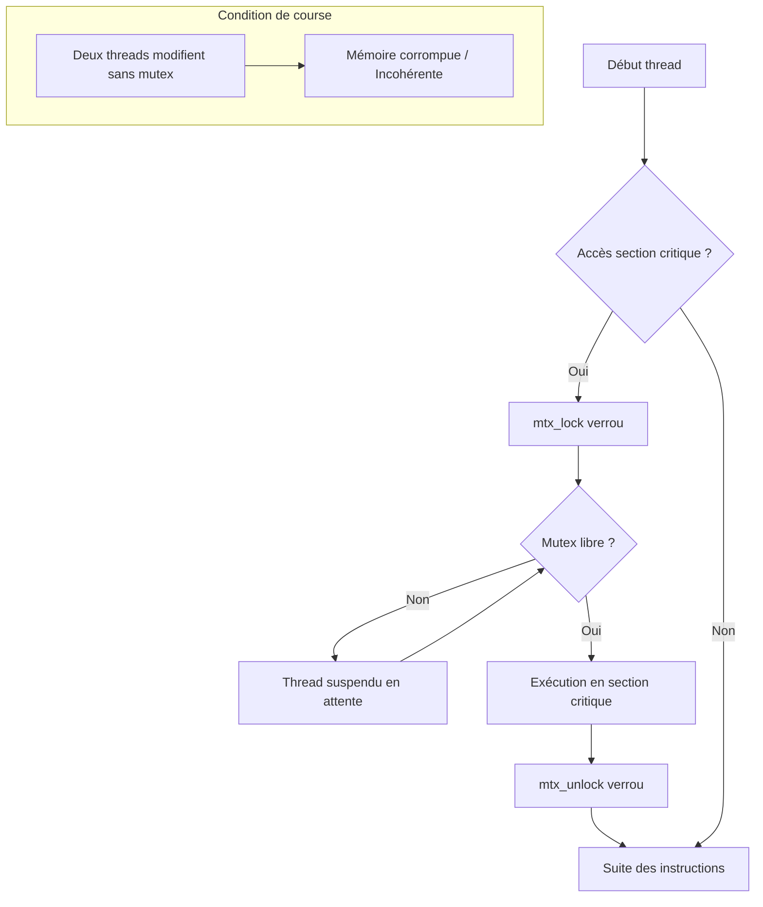

# 5-Séance 5 : Programmation Système et Multitâche  
## 2-Introduction aux Threads Standards (C11 `<threads.h>`)  
### 2-Synchronisation des threads (Mutex C11 et Variables de Condition)

---

## Introduction  
Lorsque plusieurs threads s'exécutent simultanément et accèdent aux mêmes ressources mémoire (variables globales, tableaux, pointeurs), des accès concurrents non contrôlés peuvent survenir. Ces situations génèrent des **conditions de course** (*race conditions*) ou des **interblocages** (*deadlocks*). 

La bibliothèque standard C11 (`<threads.h>`) fournit des outils de synchronisation portables entre Windows et UNIX/Linux, notamment les **mutex** (`mtx_t`) et les **variables de condition** (`cnd_t`).

---

## 1. Problèmes courants liés à la concurrence  

### 1.1 Condition de course (*Race Condition*)  
Elle survient lorsque plusieurs threads lisent et modifient une même variable partagée sans synchronisation. La valeur finale dépend de l'ordre d'ordonnancement arbitraire du système d'exploitation.

**Exemple :** Un compteur partagé incrémenté par deux threads en parallèle sans verrouillage peut perdre des incrémentations par chevauchement de cycles CPU.

### 1.2 Interblocage (*Deadlock*)  
Un interblocage se produit lorsque deux ou plusieurs threads se bloquent mutuellement de façon permanente, chacun attendant une ressource détenue par l'autre.

---

## 2. Mutex C11 : Exclusion Mutuelle (`mtx_t`)

Un **mutex** (*Mutual Exclusion*) est un verrou binaire. Seul le thread qui a verrouillé le mutex peut accéder à la section critique de code qu'il protège.

### 2.1 Fonctions clés de l'API `mtx_t`

| Fonction C11 | Description |
| :--- | :--- |
| `mtx_init(mtx_t *mutex, int type)` | Initialise le mutex. `type` vaut généralement `mtx_plain` (standard) ou `mtx_timed` (avec timeout). |
| `mtx_lock(mtx_t *mutex)` | Verrouille le mutex. Bloque si le mutex est déjà pris. |
| `mtx_unlock(mtx_t *mutex)` | Déverrouille le mutex et libère l'accès pour un autre thread. |
| `mtx_destroy(mtx_t *mutex)` | Détruit le mutex et libère les ressources système associées. |

---

### 2.2 Exemple : Protection d'un compteur avec un Mutex C11

```c
#include <stdio.h>
#include <stdlib.h>
#include <threads.h>

long compteur = 0;
mtx_t verrou; // Mutex C11

int incrementer(void *arg) {
    for (int i = 0; i < 100000; i++) {
        // Entrée en section critique
        mtx_lock(&verrou);
        
        compteur++; // Modification sécurisée de la ressource partagée
        
        // Sortie de section critique
        mtx_unlock(&verrou);
    }
    return thrd_success;
}

int main(void) {
    thrd_t t1, t2;

    // Initialisation du mutex (type mtx_plain : exclusion mutuelle simple)
    if (mtx_init(&verrou, mtx_plain) != thrd_success) {
        fprintf(stderr, "Échec de l'initialisation du mutex.\n");
        return EXIT_FAILURE;
    }

    // Création des deux threads
    thrd_create(&t1, incrementer, NULL);
    thrd_create(&t2, incrementer, NULL);

    // Attente de la fin des threads
    thrd_join(t1, NULL);
    thrd_join(t2, NULL);

    // Destruction du mutex
    mtx_destroy(&verrou);

    printf("Compteur final = %ld (Valeur attendue : 200000)\n", compteur);
    return EXIT_SUCCESS;
}
```

---

## 3. Variables de condition (`cnd_t`) et Sémaphores

Contrairement à l'API POSIX (`semaphore.h`), la norme standard C11 n'inclut pas directement de type `sem_t`. Pour synchroniser des threads selon un comptage de ressources ou une condition complexe, on utilise les **variables de condition C11** (`cnd_t`).

### 3.1 Interface C11 des variables de condition

- **`cnd_init(cnd_t *cond)`** : Initialise la variable de condition.
- **`cnd_wait(cnd_t *cond, mtx_t *mutex)`** : Libère le mutex de façon atomique et met le thread en attente d'un signal.
- **`cnd_signal(cnd_t *cond)`** : Réveille un des threads en attente sur la condition.
- **`cnd_broadcast(cnd_t *cond)`** : Réveille tous les threads en attente sur la condition.
- **`cnd_destroy(cnd_t *cond)`** : Libère les ressources de la variable de condition.

### 3.2 Implémentation d'un Sémaphore/Compteur de ressources portable en C11

```c
#include <stdio.h>
#include <stdlib.h>
#include <threads.h>

// Structure représentant un sémaphore portable C11
typedef struct {
    int value;
    mtx_t mutex;
    cnd_t cond;
} sem_c11_t;

void sem_c11_init(sem_c11_t *s, int initial_val) {
    s->value = initial_val;
    mtx_init(&s->mutex, mtx_plain);
    cnd_init(&s->cond);
}

void sem_c11_wait(sem_c11_t *s) {
    mtx_lock(&s->mutex);
    while (s->value <= 0) {
        cnd_wait(&s->cond, &s->mutex); // Attente si le nombre de jetons est <= 0
    }
    s->value--;
    mtx_unlock(&s->mutex);
}

void sem_c11_post(sem_c11_t *s) {
    mtx_lock(&s->mutex);
    s->value++;
    cnd_signal(&s->cond); // Signale à un thread en attente qu'un jeton est disponible
    mtx_unlock(&s->mutex);
}

void sem_c11_destroy(sem_c11_t *s) {
    mtx_destroy(&s->mutex);
    cnd_destroy(&s->cond);
}
```

---

## 4. Prévention des Interblocages (*Deadlocks*)

Un deadlock survient souvent lorsque deux threads verrouillent plusieurs mutex dans un ordre différent :

```
Thread A : mtx_lock(M1) --> mtx_lock(M2)
Thread B : mtx_lock(M2) --> mtx_lock(M1)  <-- Bloquant / Deadlock !
```

### Règles d'or pour éviter les deadlocks :
1. **Ordre strict d'acquisition :** Toujours verrouiller les mutex dans le même ordre à travers toute l'application.
2. **Utiliser `mtx_trylock` :** Si un mutex ne peut pas être verrouillé immédiatement, libérer les verrous déjà acquis et réessayer plus tard.
3. **Limiter la taille des sections critiques :** Conserver un code minimal entre `mtx_lock` et `mtx_unlock`.

---

## 5. Diagramme Mermaid : Gestion de l'accès aux ressources en C11



---

## 6. Synthèse des équivalences d'API (POSIX vs C11 Standard)

| Concept | API POSIX (`pthread.h`) | API C11 Standard (`threads.h`) |
| :--- | :--- | :--- |
| **Identifiant thread** | `pthread_t` | `thrd_t` |
| **Création** | `pthread_create()` | `thrd_create()` |
| **Attente** | `pthread_join()` | `thrd_join()` |
| **Mutex** | `pthread_mutex_t` | `mtx_t` |
| **Initialisation Mutex** | `pthread_mutex_init()` | `mtx_init()` |
| **Verrouillage** | `pthread_mutex_lock()` | `mtx_lock()` |
| **Déverrouillage** | `pthread_mutex_unlock()` | `mtx_unlock()` |
| **Condition** | `pthread_cond_t` | `cnd_t` |

---

## 7. Sources utilisées  

- [ISO/IEC 9899:2011 (C11 Specification) - Clause 7.26 Threads](https://www.open-std.org/jtc1/sc22/wg14/www/docs/n1570.pdf)  
- [C11 Concurrency and Threading Utilities - cppreference.com](https://en.cppreference.com/w/c/thread)  
- [Modern C (Jens Gustedt) - Thread-safe programming](https://inria.hal.science/hal-02383654)  